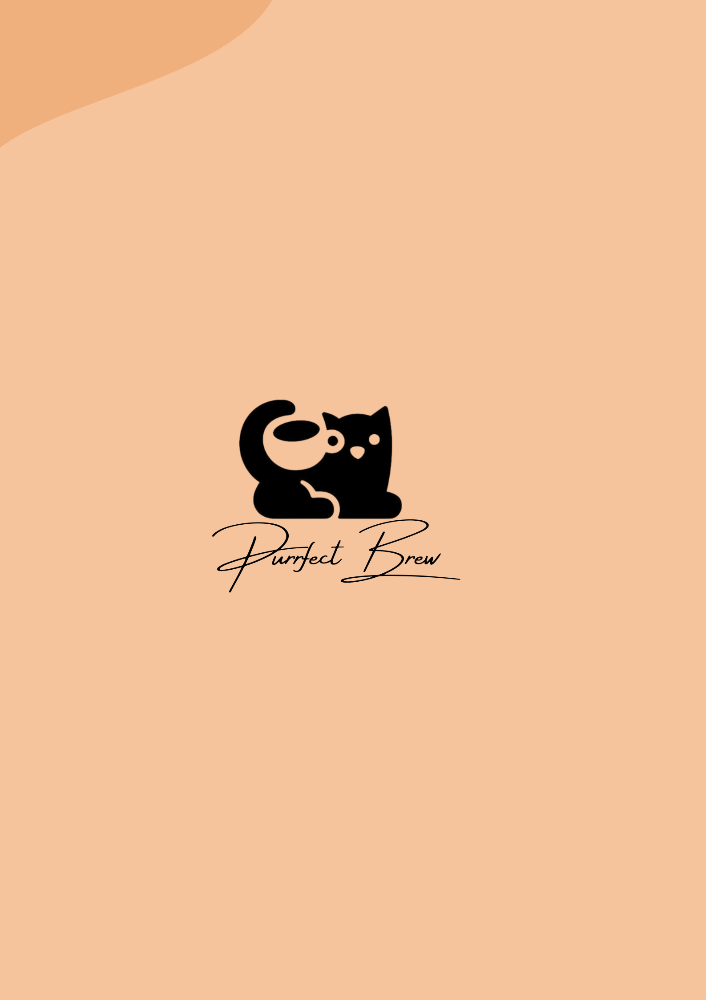
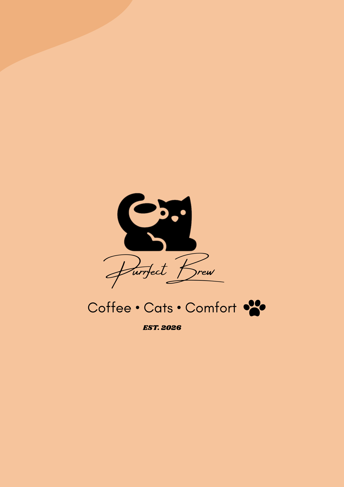
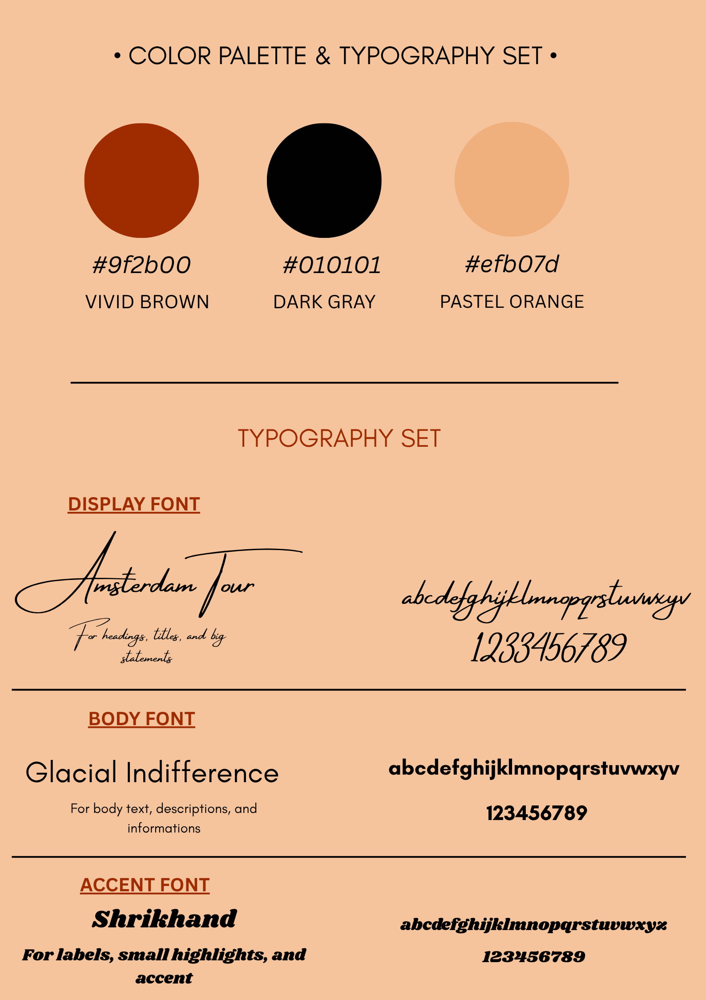
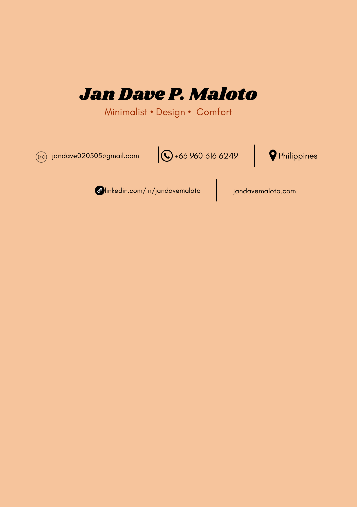

# Activity 2 — Color Palette and Typography

**Course:** GE 4120 — The 21st Century IT Skills

## 🖼️ My actual color and typography designs

### Design 1

### Design 2

### Design 3

### Design 4

---

## About this activity
This activity explores how colors and font choices affect the appearance and readability of a design.

## Activity outputs
- [Design 1](Color-and-Typography-1.png)
- [Design 2](Color-and-Typography-2.png)
- [Design 3](Color-and-Typography-3.png)
- [Design 4](Color-and-Typography-4.png)

## What have I learned?
I learned that choosing the right colors and fonts can make a design easier to understand. Colors should work well together, and the text should be easy to read. A challenge in this type of activity is finding a combination that looks good without making the design confusing. I can improve by comparing different color and font choices before choosing the final design. I can apply this when creating posters, presentations, and health teaching materials.
