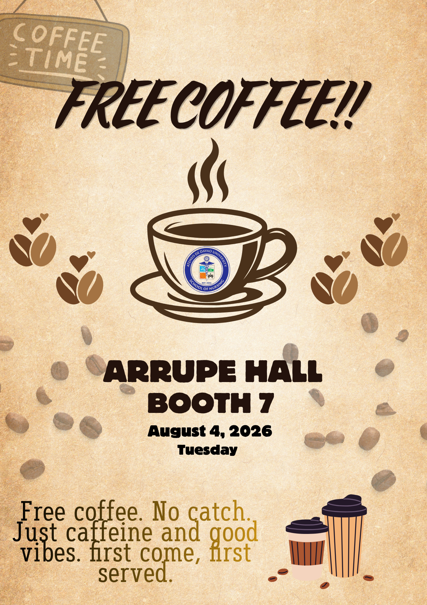
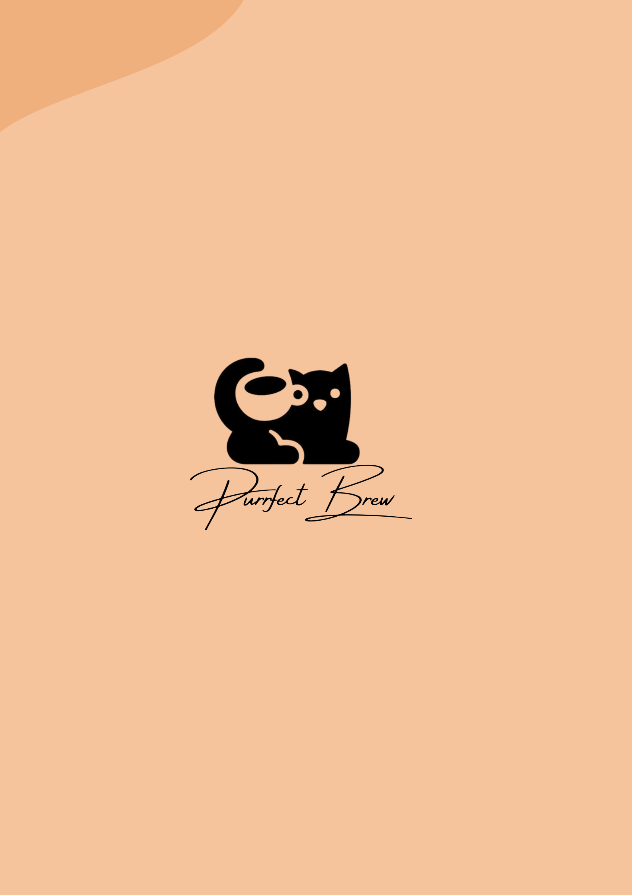
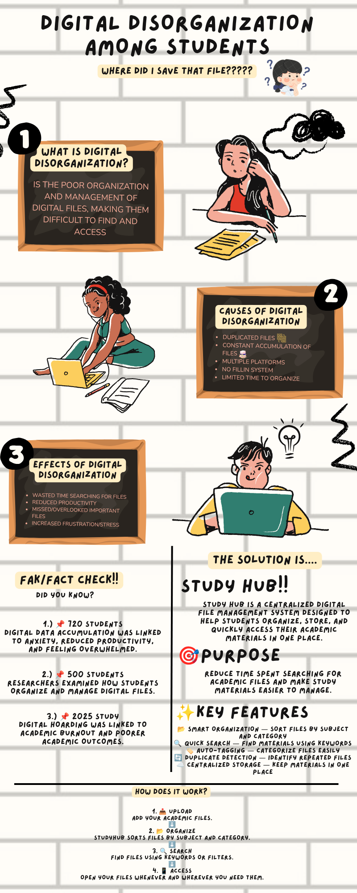

# JAN DAVE P. MALOTO

### DIGITAL PORTFOLIO · GE 4120

**Fourth-Year BS Nursing Student · Ateneo de Davao University**

*Connecting creative digital skills with meaningful health education.*

**[See My Projects](#️-see-my-actual-projects) · [Skills](#-skills--tools) · [Course Reflection](#-course-reflection)**

---

## 👋 About Me

Hello! I am **Jan Dave P. Maloto**, a fourth-year **Bachelor of Science in Nursing** student at **Ateneo de Davao University**. Welcome to my portfolio for **GE 4120 — The 21st Century IT Skills**.

This collection shows how I explored presentation design, visual communication, AI tools, and website creation. As a nursing student, I am interested in using these skills to make health information clearer, more engaging, and easier to understand.

## ✨ Portfolio at a Glance

| 🎨 Visual Design | 🤖 AI & Digital Tools | 🩺 Health Communication |
|:---:|:---:|:---:|
| Presentations, colors, typography, and infographics | AI image prompting, resume generation, and web development | Patient-friendly information and blood pressure awareness |

## 🖼️ See My Actual Projects

**These are my uploaded outputs, not sample images.** Click the image or the clearly labeled link to view the full work.

### Activity 1 · Presentation Design Principles

**[View my Activity 1 page and reflection](Activity-1-Presentation-Design-Principles/)**

### Activity 2 · Color Palette and Typography

**[See all four of my Activity 2 designs](Activity-2-Color-Palette-and-Typography/)**

### Activity 3 · Social Media Infographic

**[View Activity 3 and its documentation](Activity-3-Social-Media-Infographics-and-Documentation/)**

### Activities 4–7 · Open My Submitted Work

| Activity | Open my actual output | Read my reflection |
|---|---|---|
| **04 · Presentation Exam** | **[🎨 OPEN MY CANVA PRESENTATION](https://canva.link/rflj768aiskkt9x)** | [Activity 4](Activity-4-Presentation-Exam/) |
| **05 · AI Tools Activity** | **[🖼️ OPEN MY AI IMAGE COMPARISON PDF](https://raw.githubusercontent.com/dabidibb/Elective-/main/Activity-5-AI-Tools-Activity/Activity-5-AI-Tools-Maloto.pdf)** | [Activity 5](Activity-5-AI-Tools-Activity/) |
| **06 · BP AWARE Website** | **[🌐 OPEN MY WEBSITE PROJECT](https://replit.com/@dabidib/BP-AWARE-Website)** · [Submission PDF](https://raw.githubusercontent.com/dabidibb/Elective-/main/Activity-6-Making-a-Website/Activity-6-Website-Maloto.pdf) | [Activity 6](Activity-6-Making-a-Website/) |
| **07 · Resume Generating** | **[📄 OPEN MY RESUME COMPARISON PDF](https://raw.githubusercontent.com/dabidibb/Elective-/main/Activity-7-Resume-Generating/Activity-7-Resume-Maloto.pdf)** | [Activity 7](Activity-7-Resume-Generating/) |

> **For visitors:** The images above display directly on this page. The PDF links open the submitted documents. Each activity page also includes the description and learning reflection required for GE 4120.

---

## 🧰 Skills & Tools

| Skills Practiced | Tools Used | Application in Nursing |
|---|---|---|
| Presentation design and visual organization | Canva | Class presentations and health teaching |
| Color, typography, and infographic design | Digital design tools | Clear educational materials |
| AI prompting and comparing outputs | ChatGPT and Claude AI | Reviewing and improving digital content |
| Website creation and file organization | Replit and GitHub | Sharing health education resources |

## 🌱 Course Reflection

GE 4120 helped me understand how technology and creativity can work together. I learned that clear designs, organized information, and specific instructions can improve the quality of digital projects. I also learned to review AI-generated results instead of relying on them without checking. As a future nurse, I can use these skills to prepare presentations, create educational materials, and explain health information in a way that people can understand.

---

**Thank you for visiting my digital portfolio!**

*GE 4120 · The 21st Century IT Skills · Ateneo de Davao University*

